# TVControl

**An open-source, vibe-coded Android remote for Android TV and Google TV.** This is a personal project built with AI-assisted coding and tested on real hardware. The remote runs on **Android phones and tablets (Android 8.0 or later)** and controls compatible Android TV and Google TV devices on your local network.

[GitHub Releases](https://github.com/jurim007/android-tv-remote/releases) · [Setup guide](#setup-guide) · [Roadmap](#roadmap) · [MIT license](LICENSE)

<p>
  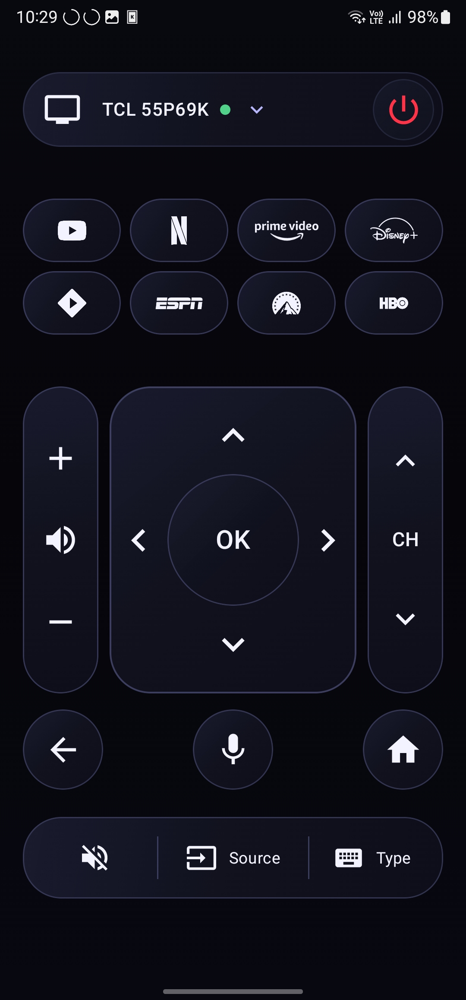
  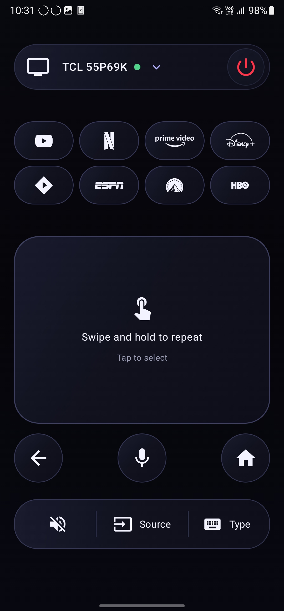
  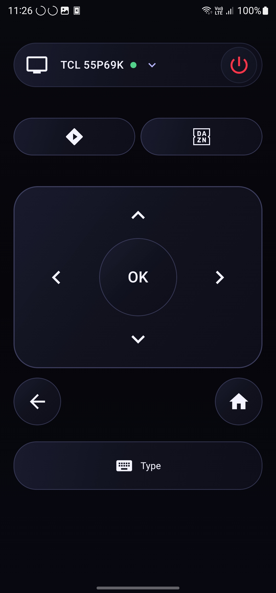
</p>

## What you can do

- Navigate with an on-screen **D-pad** or **swipe pad**, with Back, Home, and power controls.
- Adjust volume and channels, mute the TV, and open its native Inputs menu on compatible devices.
- Send text and delete characters in a focused TV text field. Use your phone’s microphone for TV voice search on supported devices.
- Launch up to eight apps per TV from the remote. Shortcuts support bundled logos, custom images, and drag-to-reorder.
- Save multiple TVs and customize which controls appear, whether buttons vibrate, and whether the phone’s volume keys control the TV.

## Setup guide

### 1. Install TVControl

Download the APK from [GitHub Releases](https://github.com/jurim007/android-tv-remote/releases) when a release is available, or [build the debug APK](#build-from-source). Open the APK on your Android device and follow Android’s installation prompt.

### 2. Find your TV

Turn on your Android TV or Google TV and connect it and your phone to the same local network. In TVControl, tap the TV selector at the top, then tap **+**. Choose **Pair** next to your TV under **Nearby TVs**. If discovery doesn’t find it, enter the TV’s local IP address or hostname and tap **Add by IP**.

### 3. Pair and connect

The TV displays a six-character pairing code. Enter the code currently shown on the TV, optionally edit the TV name, and tap **Pair and connect**. The status dot turns green when the remote is connected. Choose a saved TV from the top selector to switch devices, or go to **Remote settings → Devices → Manage TVs** to remove one.

<p>
  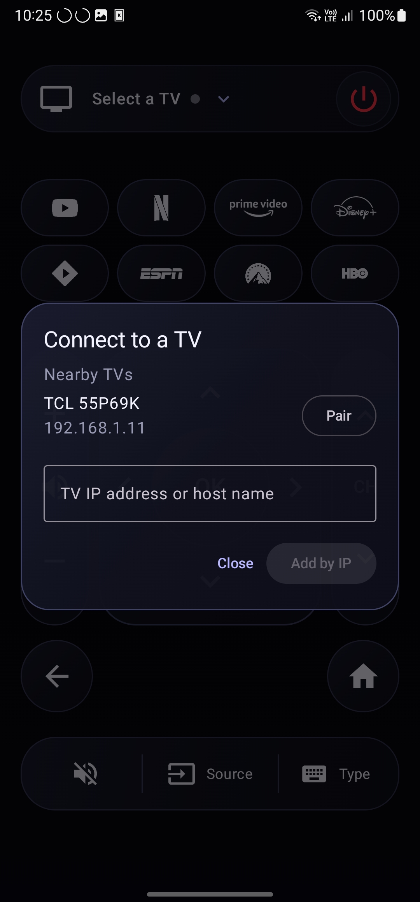
  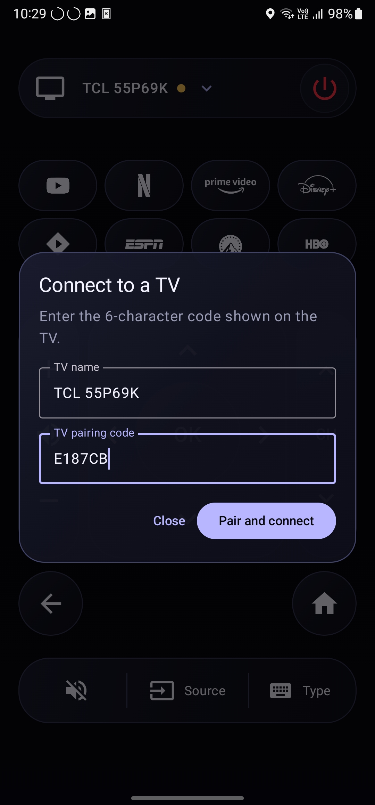
  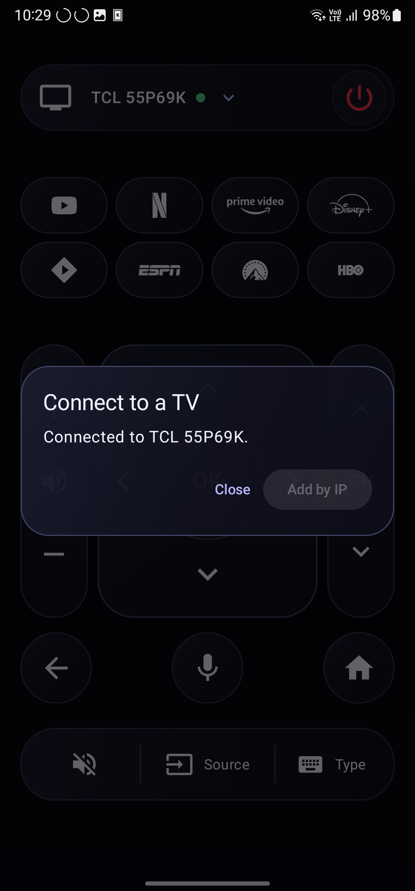
</p>

<details>
<summary>What the pairing prompt looks like on the TV</summary>

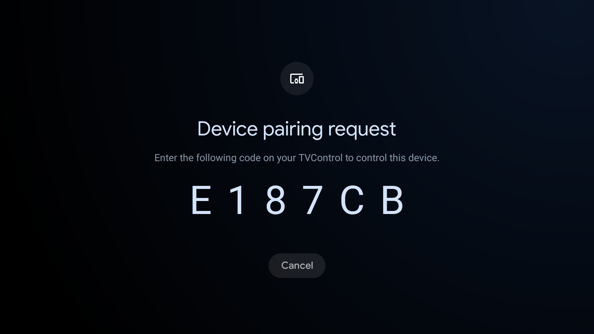

</details>

## Using the remote

| Control | How it works |
| --- | --- |
| **Button D-pad** | Tap an arrow to move once, or hold it to repeat. Tap **OK** to select. |
| **Touchpad** | Swipe to move, swipe and hold to repeat, or tap to select. |
| **Type** | Focus a text field on the TV and open **Type** on your phone. **Send text** transfers text and keeps the dialog open. **Enter** sends any draft, runs the TV field’s action (such as Search or Done) when available, and closes the dialog. The delete icon erases a character on the TV. |
| **Microphone** | Tap the mic between Back and Home, grant microphone access if prompted, and speak. TVControl sends the audio to the paired TV for processing. Tap **Stop** to finish. Recording also stops when you leave the remote or after 20 seconds. |
| **Source** | Opens the TV’s native Inputs panel where supported. Navigate with the D-pad or swipe pad and select an input. See the [TCL setup](#source-on-tcl-tvs) if your TV ignores the standard Source key. |

### Customize the layout

Open **Remote settings** from the TV selector. Switch between **D-pad** and **Touchpad** on the home screen. In **Remote settings → Remote layout**, turn off **Show Navigation Mode Selector** to hide the selector while keeping the current mode. You can also toggle volume, channels, Mute, Source, app shortcuts, and the microphone. The navigation pad expands into the space freed by hidden side controls. With the microphone shown, it stays in place and appears dimmed until a voice-capable TV is connected.

Under **Button behavior**, vibration starts on and phone volume-key control starts off. Enable **Phone volume buttons** to adjust a connected TV that supports volume control. **Restore defaults** asks for confirmation and resets the remote preferences and the selected TV’s shortcuts. Paired TVs stay saved.

<p>
  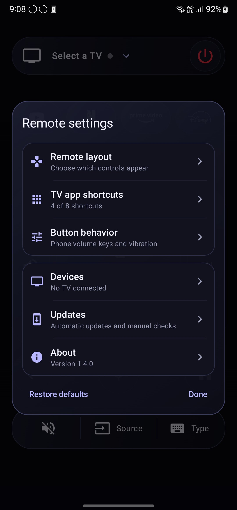
  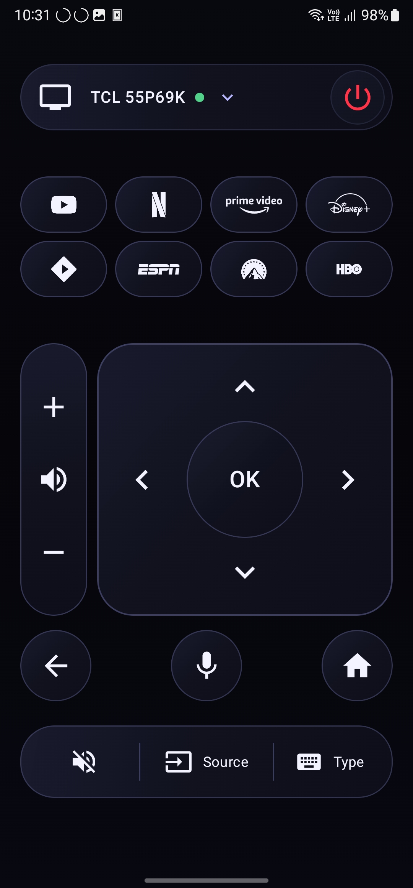
  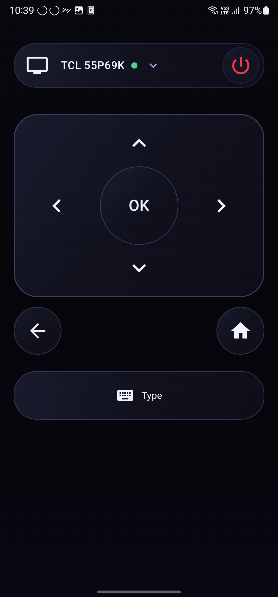
</p>

## TV app shortcuts

Choose a saved TV, then go to **Remote settings → TV app shortcuts**. Each TV has its own list. YouTube, Netflix, Prime Video, and Disney+ are included by default. You can save up to eight shortcuts in two rows of up to four, and each row fills the available width.

1. Tap **Add TV app** and start typing the app name. Select a suggestion to fill in the app name and package ID. For an app outside the catalog, enter the package ID for the version installed on your TV.
2. Keep the matched logo, use **Choose image** to import a PNG, JPEG, WebP, or SVG, or use **HTTPS SVG / image link** to paste a direct link. SVGs use the theme’s icon color. Use **Remove image** while editing to return to the matched logo.
3. Tap **Add app**. Tap a shortcut in settings to **Edit** or **Remove** it, or touch and hold it before dragging to reorder. Removal asks for confirmation. **Restore default shortcuts** brings back the four bundled entries for the current TV.

Existing shared shortcuts move to the selected saved TV, or to the first saved TV if none was selected. If you had no saved TVs, the shortcuts follow the first TV you pair.

<p>
  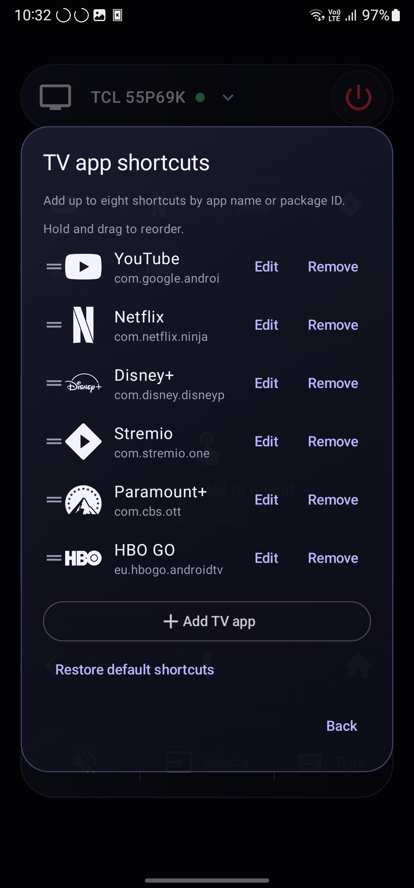
  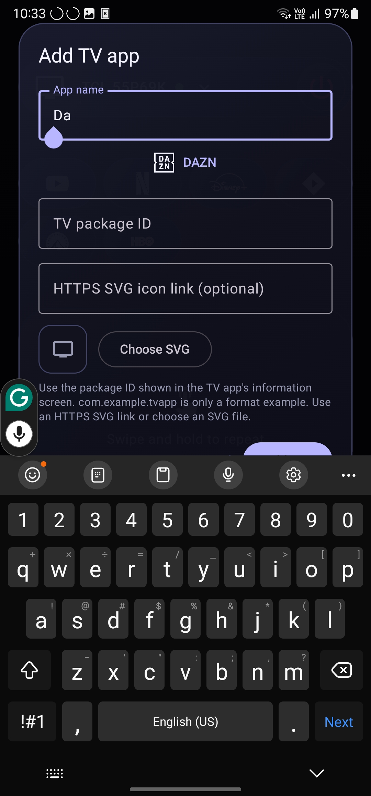
  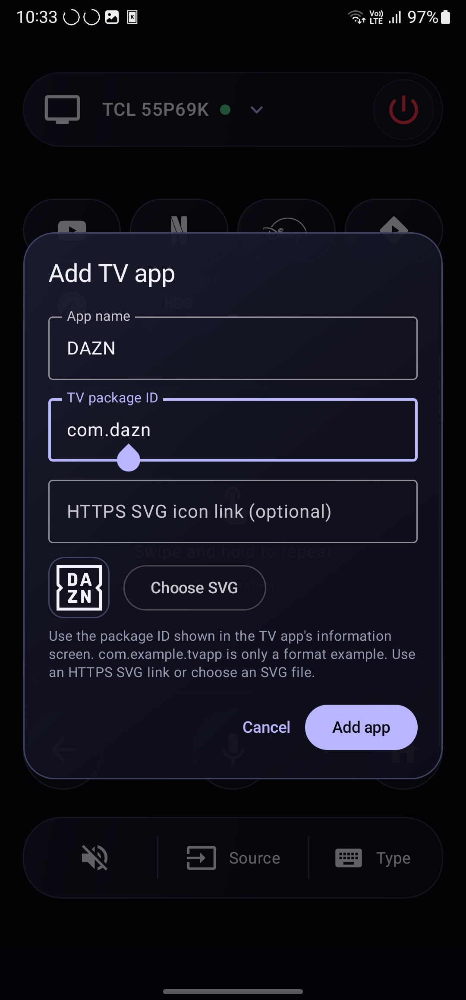
</p>

### When a shortcut won’t launch

Confirm that the app is installed on the TV and that its package ID matches the TV version. Known apps such as YouTube and Netflix use built-in launch links. Other shortcuts use a package-launch link, which some TV software needs a handler to open.

If a package-ID shortcut fails, install and open [AVA Connect](https://play.google.com/store/apps/details?id=com.ava.connect) **on the TV**, complete the setup and permissions it requests, then try again. The core remote works over normal pairing without AVA Connect. [AVA Connect setup guide](https://support.ava.com/hc/en-us/articles/38717944348061-Fix-for-Google-TV-Android-TV-App-Launching-Broken-by-Google-s-Play-Store-Update-in-August-2026)

### Source on TCL TVs

On the tested **TCL 55P69K**, the firmware ignores the standard Source key over the network. With AVA Connect set up on the TV, connect in TVControl and enable **Remote settings → Devices → TCL Inputs via AVA Connect**. This setting applies only to that paired TV. Tap **Source** to open the built-in Inputs panel, then navigate to the input you want. Source behavior varies across TV models and firmware.

## Troubleshooting

| Symptom | What to check |
| --- | --- |
| TV is missing from **Nearby TVs** | Check that both devices are on the same local network. Guest Wi-Fi can block communication between devices. Try **Add by IP** if discovery is unavailable. |
| Pairing code is rejected | Start pairing again and enter the new six-character code shown on the TV. |
| Remote buttons don’t respond | Confirm the status dot is green and the correct TV is selected. If the TV rejects its saved pairing, choose **Pair again** from the TV selector and enter the new code. If the TV’s address changed, pair using its new address. |
| Text or backspace does nothing | Focus an editable field on the TV first. Text input support can vary by TV app. |
| Mic is dimmed or missing | Check **Show microphone** under **Remote layout**, connect to a TV that advertises voice support, and allow TVControl to use the phone’s microphone. |

## App updates

TVControl checks GitHub for stable releases on launch. In **Remote settings → Updates**,
**Automatic Updates** controls launch checks and automation. **Automatic Downloads**
uses validated, unmetered connections and resumes interrupted downloads when GitHub
supports it. **Automatic Installation** asks Android to install automatically downloaded
updates. Both extra options are off by default. **Check for updates** is always available.

The first installation through TVControl may require enabling **Allow from this
source** in Android settings. On Android 12 and later, TVControl can request a
self-update without confirmation. Android may still ask you to confirm or block
the install according to its security settings. Android 8–11 use system
confirmation. In-place updates preserve your paired TVs and settings.

## Roadmap

These features are planned and are not available yet.

- [ ] Support for more TV operating systems, starting with exploration of Samsung Tizen and LG webOS.
- [ ] Broader testing across Android TV and Google TV models, especially for Source, voice search, and package-ID app launches.

## Build from source

TVControl is built with Kotlin, Jetpack Compose, and Material 3. Use **JDK 17** and install **Android SDK Platform 36**. Open the project in Android Studio or run the Gradle wrapper from the repository root.

```bash
git clone https://github.com/jurim007/android-tv-remote.git
cd android-tv-remote
./gradlew :app:testDebugUnitTest :app:assembleDebug
```

The debug APK is at `app/build/outputs/apk/debug/app-debug.apk`. To install it on a connected Android phone, run `adb install -r app/build/outputs/apk/debug/app-debug.apk`. On Windows, use `gradlew.bat` in place of `./gradlew`.

TV discovery uses mDNS. New pairings use a unique client certificate and private key stored locally outside Android backups. The app also pins the TV’s TLS certificate for subsequent connections. Existing pairings keep their previous identity until you pair that TV again. DataStore holds saved TVs and local preferences.

### Versioning

Use GitHub release tags in the form `vMAJOR.MINOR.PATCH`, starting with `v1.0.0`. Major releases cover substantial changes such as a new TV platform, minor releases introduce features, and patches cover fixes and small UI changes. Build the APK from the release tag before attaching it to GitHub Releases.

Publish the signed `TVControl-vMAJOR.MINOR.PATCH.apk` and its
`.apk.integrity` companion together. Generate the companion locally after signing
the APK, using the same release keystore and a file containing its passphrase.

```bash
java tools/SignUpdateIntegrity.java "$APK" com.jurim007.androidtvremote "$KEYSTORE" "$PASSWORD_FILE"
```

The companion authenticates the APK’s SHA-256, size, version, and package name.
TVControl verifies it against the currently installed signing certificate.
Keep the release key and passphrase out of GitHub Releases. Older releases
remain downloadable, and the improved updater requires the signed companion
for any release it installs.

The **About** section displays the version embedded at build time and a GitHub author badge. Gradle reads the workflow’s tag and repository owner in GitHub Actions. Local builds use the latest reachable version tag and the owner of the GitHub `origin` remote. The fallback version is `1.0.0`. For a local override, use `-PreleaseVersion=1.2.3`.

## Contributing and license

TVControl is released under the [MIT License](LICENSE). Forks, pull requests, and bug reports are welcome. For device-specific issues, include the TV model, its OS version, the TVControl version, and steps to reproduce. [GitHub Issues](https://github.com/jurim007/android-tv-remote/issues)

Most bundled shortcut logos and the GitHub mark come from [Simple Icons](https://simpleicons.org/). The [Prime Video mark](https://cdn.jsdelivr.net/npm/simple-icons@11.0.0/icons/primevideo.svg) comes from Simple Icons v11. The CloudStream SVG was contributed to the project. The remaining wordmarks listed here come from Wikimedia Commons. [Disney+](https://commons.wikimedia.org/wiki/File:Disney%2B_logo.svg) · [ESPN](https://commons.wikimedia.org/wiki/File:ESPN_wordmark.svg) · [Hulu](https://commons.wikimedia.org/wiki/File:Hulu_logo_(2018).svg) · [Peacock](https://commons.wikimedia.org/wiki/File:NBCUniversal_Peacock_Logo_(2026).svg) · [Pluto TV](https://commons.wikimedia.org/wiki/File:Pluto_TV_logo_2024.svg) · [Viki](https://commons.wikimedia.org/wiki/File:Rakuten_Viki_2022.svg)
